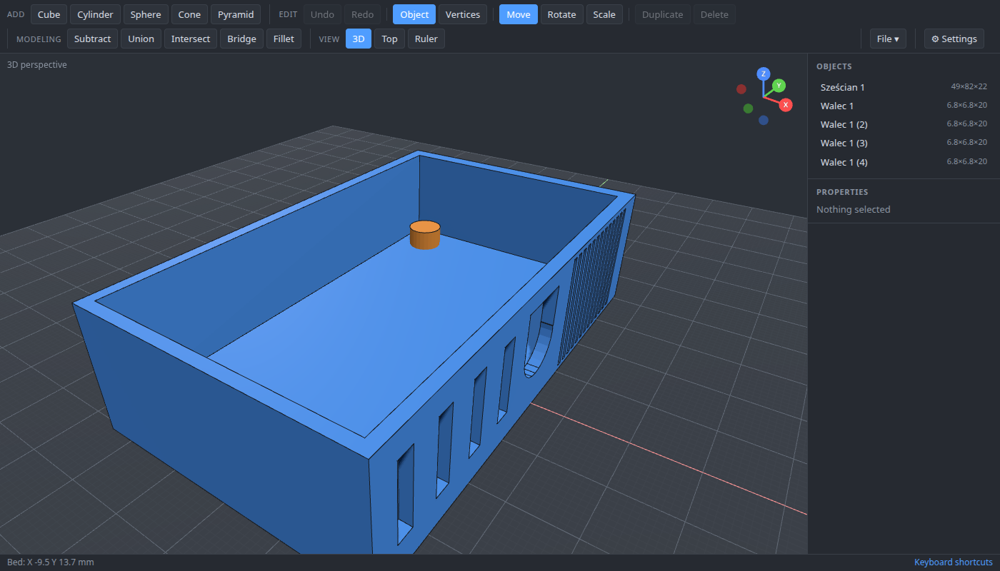

# 3D Modeler

A simple solid modeling program designed for **3D printing**. It runs locally in the browser
(no server, no internet connection), works in millimeters with the Z axis pointing up – just like
slicers – and always saves watertight solids ready to print.

> The user interface is available in **English and Polish** – switch it in **⚙ Settings → Language**
> (the choice is remembered; by default the browser language is used).



## Getting started

Requires Node.js 18+.

```bash
npm install
npm run dev        # development server → http://localhost:5173
```

Production build (static files in `dist/`, can be served from any file server):

```bash
npm run build
npm run preview
```

The program can later be packaged as a desktop app (e.g. Tauri or Electron) without code changes.

## Features

### Solids and objects
- **Primitives**: cube, cylinder, sphere, cone, pyramid (20 mm, standing on the bed).
- **Move, rotate, scale** with gizmos in the viewport (W / E / R) or numerically in the panel.
- **Dimensions in mm** in the panel; for cylinders, cones and spheres also **diameter / radius / height**.
- **Drop to bed** – lowers the solid so its lowest point lies at z = 0.
- **Duplicate** (Ctrl+D) – a copy next to the original with a 5 mm gap; **linear array**
  (number of copies, gap, X/Y direction) with a warning when copies extend beyond the bed.
- **Undo / redo** (Ctrl+Z / Ctrl+Y) for all operations.

### Vertex editing ("Vertices" mode, Tab)
- **Drag vertices** with the mouse: horizontally, or with Shift vertically only (Z).
- **Grid snapping** 0.5 / 1 / 5 / 10 mm – in the ⚙ Settings menu (hold Alt while dragging to disable).
- **Multi-select vertices** (Ctrl+click, Ctrl+A) and type coordinates in the panel.
- **Add vertices**: double-click on an edge or face (with a placement preview).
- **Symmetry (mirror)** across the solid's X / Y / Z axis (M key): changes on one side
  are mirrored on the other. The mesh is automatically prepared to be symmetric
  triangle-for-triangle; unpaired vertices are highlighted in red.

### Solid operations ("Modeling" group)
All of them work the same way: click the tool in the toolbar, then pick in the viewport
(hint in the status bar); Esc or clicking the tool again cancels.
- **Subtract / Union / Intersect** (CSG) – click solid A, then solid B
  (the currently selected solid becomes solid A right away). E.g. a cylinder subtracted from a cube makes a hole.
- **Bridge** (B) – connects two flat faces (of the same or different solids) with new faces.
  Outlines may have a different number of points (e.g. square → circle). Faces at an angle are joined
  with an **arc** (↑/↓ – number of segments, ←/→ – rotate the matching). Preview before confirming,
  warnings about passing through solids and too tight a bend; a non-watertight result cannot
  be confirmed. A **panel** in the viewport guides you step by step (1st face → 2nd face),
  holds the arc segments and matching controls, shows warnings and has the **Create bridge**
  button, active only when the bridge can be created.
- **Fillet and chamfer edges** (F) – click edges (the whole circle of a cylinder is one edge),
  radius / width and smoothness in the panel, **live preview**. Convex edges are
  rounded, concave corners are filled with an arc.

### View and measurement
- **3D view** (P) and **top view** (T); 220 × 220 mm bed with a 1 and 10 mm grid.
- **Axis indicator** in the corner – clicking an axis aligns the view along it.
- **Ruler** (D) – distance between **vertices and edges** (also across different solids):
  - vertex ↔ vertex – straight between the points,
  - vertex ↔ edge – line perpendicular to the edge,
  - edge ↔ edge – line perpendicular to both edges (shortest distance, e.g. the width
    of a slot); for parallel edges it passes through the click location.
  Corners take precedence over edges; points in the middle of a smooth edge (e.g. on a cylinder's
  circle) do not. The measurement follows moved solids and vertices; ⊥ in the label = perpendicular measurement.

### Files ("File ▾" menu)
- **Save / Open** project (JSON, Ctrl+S / Ctrl+O) – preserves shape, position, colors and names.
- **STL export** (binary) and **3MF export** (mm units, separate objects with names
  and colors). A warning is shown when part of a solid is below the bed.

## Window layout

- **Top toolbar** – groups by purpose: *Add* (solids), *Edit* (undo/redo, object/vertex
  mode, move/rotate/scale, duplicate, delete), *Modeling*
  (subtract, union, intersect, bridge, fillet), *View* (3D, top, ruler),
  and on the right the **File ▾** menu (open, save, STL / 3MF export) and **⚙ Settings**
  (grid snapping, grid step, interface language).
- **Right panel** – object list and **properties** of the selected solid (name, color,
  position, rotation, dimensions, drop to bed, linear array).
- **Status bar** at the bottom – hints for the active tool, measurement results, warnings;
  in the right corner a **"Keyboard shortcuts"** link opens a cheat sheet (also the **?** key).

## Controls

| Mouse | Action |
|---|---|
| LMB | select / drag / pick |
| RMB | orbit view |
| MMB | pan view |
| Wheel | zoom |

| Key | Action |
|---|---|
| Tab | object ↔ vertex mode |
| W / E / R | move / rotate / scale |
| T / P | top / 3D view |
| Ctrl+S / Ctrl+O | save / open project |
| Ctrl+D | duplicate |
| Del | delete solid |
| Ctrl+Z / Ctrl+Y | undo / redo |
| M | symmetry off / X / Y / Z (vertex mode) |
| D | ruler |
| B | bridge |
| F | fillet edges |
| Enter | confirm (bridge, fillet) |
| Esc | cancel / step back / exit tool |
| ? | keyboard shortcuts window |

## Technologies

- [TypeScript](https://www.typescriptlang.org/) + [Vite](https://vitejs.dev/)
- [three.js](https://threejs.org/) – rendering, cameras, gizmos, STL export
- [Manifold](https://github.com/elalish/manifold) (`manifold-3d`, WebAssembly) – boolean
  operations on solids; guarantees watertight results
- [fflate](https://github.com/101arrowz/fflate) – ZIP archive for the 3MF format

## Code structure

```
src/
  main.ts          wires everything together: toolbar, mouse, keyboard, tools
  model.ts         document: solids, selection, undo history, saving
  primitives.ts    primitive solids and mesh cleanup (vertex welding etc.)
  viewport.ts      renderer, 3D / top cameras, bed, move gizmos
  axisGizmo.ts     axis indicator in the viewport corner
  vertexEditor.ts  vertex editing: dragging, adding, symmetry
  mirror.ts        mirror logic: vertex pairs, mesh symmetrization
  csg.ts           boolean operations (Manifold)
  bridge.ts        "Bridge" tool
  fillet.ts        edge filleting and chamfering
  measure.ts       ruler
  io.ts            project save / load, STL and 3MF export
  ui.ts            side panel: object list and properties
  i18n.ts          interface translations (Polish / English)
```

The scene data model stores solids as indexed triangle meshes (shared vertices),
so vertex editing does not tear the mesh and exports are watertight.

## Limitations

- Bridge only connects **flat faces without holes**.
- Filleting works on the edges of one solid at a time; a corner where three
  filleted edges meet is not a perfect sphere segment.
- Cylinders, cones and spheres have a fixed number of sides (24) – a hole defined by diameter is
  a polygon, so allow 0.2–0.3 mm of clearance for screw holes.
- "Save" downloads the file to the Downloads folder (it does not overwrite the opened file).
